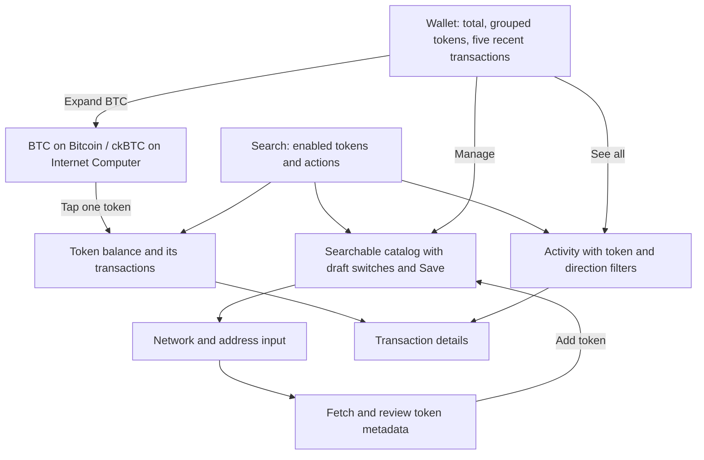

# Native wallet screens and activity plan

**Historical plan, superseded 2026-10-27.** The separate Swift wallet has been retired.
See the [current Capacitor handoff](../2026-10-27-feat-mobile-shared-web-native-navigation/handoff.md).

Requested 2026-10-24. This extends the native MVP with grouped tokens, token management, a token
page, custom-token imports and recent transactions. Custom imports were explicitly included by the
user on 2026-10-24. The first delivery is an interactive sample-data UI; live integration
follows M2 and M3. This document records proposed native behavior, not a claim of web or live parity.

## Mock UI implementation status

Implemented locally on 2026-10-24 at the user's request to test with mock data. The supported sample
catalog has the original seven assets plus optional USDC. Import examples are BAT on Ethereum,
ckUSDT on Internet Computer and SepoliaUSDC. All imports and enabled preferences stay in memory.
This completes only the UI slice; real metadata lookup, account persistence and live history remain
behind the integration gates below. Import success returns to management and preserves unrelated
draft switches, rather than automatically leaving the sheet for token detail. Transaction details
use native pushed navigation instead of stacking another sheet over the management flow.

Native adaptation of the requested make-interfaces-feel-better skill: system `List`, `Form`,
`DisclosureGroup`, navigation and sheets own their surfaces, corner treatment and pressed states.
Use SF Pro text styles, Dynamic Type, wrapping fallbacks, monospaced digits and neutral icon outlines.
Only group expansion adds a 220 ms smooth animation, disabled with Reduce Motion. No staged entrance,
CSS effects or extra motion dependency. The review confirmation stays above the bottom safe area.
The platform references are Apple's [buttons](https://developer.apple.com/design/human-interface-guidelines/buttons)
and [sheets](https://developer.apple.com/design/human-interface-guidelines/sheets) guidance.

Historical simulator results and visual evidence remain in the [local archive](./handoff.md#local-archive).

## Web behavior inspected

Paths below are relative to the repository root, inspected on the local native branch based on
`claude/iphone-app-support-5de37c`. This is a source audit, not a review of the current deployment.

| Area              | Existing source                                                                                                                                    | Behavior to preserve                                                                                                                                                           |
| ----------------- | -------------------------------------------------------------------------------------------------------------------------------------------------- | ------------------------------------------------------------------------------------------------------------------------------------------------------------------------------ |
| Grouping          | `src/frontend/src/lib/utils/token-group.utils.ts`, `lib/components/tokens/TokenGroupCard.svelte` (under `src/frontend/src/`)                       | Explicit group metadata; combine amounts and USD values, retain distinct network members. Header expands; member opens its own history. Single-member groups render as tokens. |
| Identity          | `docs/ai/frontend/stack-and-patterns.md`, `env/tokens/`                                                                                            | Tickers are not identifiers. Native keys use network plus native asset, contract address or ledger ID. Testnet is separate.                                                    |
| Management        | `lib/components/manage/ManageTokens.svelte`, `lib/utils/tokens.utils.ts`                                                                           | Search/filter catalog, edit a draft, Save/Cancel. Persist through chain-specific backend methods. Import is a separate workflow.                                               |
| Custom imports    | `lib/components/manage/ManageTokensModal.svelte`, `eth/components/tokens/EthAddTokenReview.svelte`, `icp/services/ic-add-custom-tokens.service.ts` | Network/address input, metadata validation, review, then persistence. ICRC index is optional but must match the ledger if supplied.                                            |
| Mandatory tokens  | `btc/components/tokens/BtcManageTokenToggle.svelte`, `icp/utils/token-toggle.utils.ts`                                                             | BTC cannot be hidden. Core ICP and default ckBTC/ckETH/ckUSDC are also protected; native ETH has no management toggle.                                                         |
| Token page        | `lib/components/hero/HeroContent.svelte`, `lib/components/transactions/Transactions.svelte`                                                        | Exact token/network identity, amount, fiat value, price where available, and chain-specific history. Web financial actions depend on separate flows.                           |
| Activity          | `lib/components/transactions/AllTransactionsList.svelte`, `lib/services/transactions-pagination.services.ts`                                       | Merge chain histories, sort/group by date, filter display independently of pagination, open chain-specific details. Missing history is distinct from an empty wallet.          |
| Active operations | `lib/components/active-user-transactions/ActiveUserTransactionsList.svelte`                                                                        | In-progress/failed workflow tracking is separate from ledger history. Do not present it as complete transaction history.                                                       |

## Native navigation

Keep Wallet, Browser and Settings. The user-approved 2026-10-26 refinement restores a functional
Search tab with the native search role, positioned separately on the right of the tab bar. Selecting
it opens token/action search; Wallet has no inline field. Both screens share the portfolio model,
so imports and enabled-token edits are immediately reflected. Swap and Buy are searchable with
explicit preview-unavailable labels and explanations; Manage Tokens and Activity open their existing
flows. Signed-out Search routes to Wallet without exposing sample token balances.
Use native navigation and sheets:

### Tokens and groups

- Keep the original seven assets. Add Ethereum USDC to the sample catalog, initially disabled, so
  management can be exercised without making protected core assets hideable. Its metadata comes
  from `env/tokens/tokens-erc20/tokens.usdc.env.ts`; live ERC-20 balance support is a later addition.
- BTC groups BTC and ckBTC; ETH groups ETH and ckETH. Enabled USDC groups with ckUSDC. Sepolia ETH
  remains a separate, explicitly labeled testnet asset and contributes nothing to USD totals.
- Header shows group symbol, combined amount and USD value. Expansion shows exact token name,
  network, amount and value. A single visible member navigates directly to that token.
- Native first slice sorts groups by aggregate USD value, then name, and members by USD value.
  This is a deliberate native choice: the web grouping utility preserves first-member position.
- Search names, symbols and networks. Network filtering changes visible rows, not the portfolio
  total. Search returns exact enabled members. Initially show all enabled members, including zero
  balances; the web's additional zero-network folding can follow when the catalog grows.

### Manage tokens

- Sheet with search and network filter, token/network rows and Save/Cancel.
- Core tokens are visibly required. Optional assets have switches. A group never has one switch
  that silently changes several networks.
- Save is enabled only for changes. Cancel discards changes. Search does not discard draft edits.
- First UI slice uses in-memory sample preferences, lasting while that Wallet view is open. It
  states this clearly. It does not change the signed-in user's web preferences.
- Live management must load the backend's enabled catalog, save only changed assets through existing
  chain-specific methods and handle partial failures/version conflicts without claiming all saved.
  Preferences and caches must be scoped to the principal; sign-out clears account state.

### Custom-token import (included now)

Use a pushed flow within Manage Tokens, with native Back navigation and an explicit review step.
The first native networks are Ethereum mainnet, Sepolia and Internet Computer. Support fungible
ERC-20 and ICRC tokens; Bitcoin has no contract import in this flow. More EVM chains, Solana and NFTs
remain outside the existing native network scope.

1. **Input:** choose the network, paste the contract or ledger address. For ICRC, offer an optional
   index canister field with an explanation that it enables history. Use explicit Paste so the app
   does not read the clipboard automatically. Changing network/address invalidates prior metadata.
2. **Validate and load:** validate address/principal syntax; detect an existing token by stable
   identifier plus network. If hidden, offer to enable the existing entry. Fetch actual metadata;
   a syntactically valid address is not sufficient. Read ERC-20 name, symbol and decimals through
   the chosen chain's RPC and confirm supported behavior. Read ICRC metadata through the IC client;
   if an index is supplied, query its ledger ID and require a match.
3. **Review:** show name, symbol, network, complete contract/ledger identifier, decimals and optional
   index. Use a generic icon for unknown assets. Do not assign a trusted brand icon, BTC/USDC group
   membership, price or verification status from an untrusted token's symbol. Use explicit trusted
   catalog identifier mappings when available. Preserve the web's warning that adding a token does
   not establish its authenticity, without introducing extra confirmation dialogs.
4. **Add:** persist and enable the token using the same backend representation as the web; refresh
   the account catalog and open its token page after success. Never write or broadcast a financial
   transaction. Keep the review and error available on save failure. Retrying must not create a
   duplicate. Importing an existing asset should enable it, not create another record.
5. **After import:** load its balance with its declared decimals. Unknown fiat value stays unavailable,
   not USD zero. ICRC without an index may display its balance with a clear history-unavailable
   state. Imported tokens remain manageable and are restored from the backend on another sign-in.

Cancel/back preserves input while within the flow but performs no save. Token-management draft
changes remain separate: importing a token must not silently save unrelated switches. After a
successful import, rebase those draft changes on the refreshed catalog rather than discard them.
Cancel an in-flight lookup when input changes; discard late responses. A changed/expired account
must invalidate the import session and cannot save into another principal's catalog.

The web also rejects duplicate symbols within the relevant token catalog/network. Preserve that
validation initially, with a specific conflict message; this is distinct from stable token identity.
Handle malformed/incomplete metadata, unsupported standards, wrong network, timeouts, incorrect
index, duplicate asset, symbol conflict and persistence failure separately. Never manufacture
metadata when lookup fails. Cap metadata display lengths and allow long identifiers to wrap/copy.

A sample UI can demonstrate these states through deterministic lookup results, but it must label
that mode and must not accept an arbitrary real address while pretending an on-chain import worked.
Live ERC-20 and ICRC import adapters and backend saving are part of this requested scope. This
feature is not complete until real import, relaunch and web/native persistence parity pass.

### Token page

- Native title, official icon and explicit network, balance in token units and USD when available.
- Show unit price only when supplied; do not infer it from a zero balance. Sepolia has no fiat price.
- Show that exact token's activity and transaction details. A ckBTC page never includes BTC transfers.
- No inert Send/Swap/Buy buttons. Those flows remain separate scope. Receive needs verified address
  derivation and network-specific instructions before it can become usable.
- Updated 2026-10-25 at the user's request: compact token header and a small seven-day price chart
  built with native Swift Charts. Preview uses explicitly labeled deterministic prices for known
  sample asset IDs only. Live historical pricing still needs a provider and data contract; no chart
  is fabricated for custom assets or testnet tokens without history.

### Recent transactions

- Five latest available entries on Wallet, full local list under See all, and token-filtered history
  on the token page. Rows show direction, token/network, signed quantity, date and explicit status.
- Detail sheet shows amount, status, network, date and fee where known. Sample entries remain clearly
  marked and do not link fabricated hashes to explorers.
- Live model must allow chain-specific operations beyond Send/Receive, preserve unknown operations,
  and key entries by network + transaction ID + event/operation index as needed. A hash alone cannot
  identify every transfer. Group dates in the user's time zone with deterministic tie ordering.
- Live lists need initial loading, empty, unavailable index, partial failure, stale results, refresh
  and retry states. Failure must not be represented as zero balance or no transactions.
- Fetch initial pages for every enabled supported source before claiming a complete recent list.
  Label partial coverage. Keep per-source pagination cursors, merge/deduplicate refreshes, retain
  older pages and never derive paging cursors from the filtered display list.

## Implementation order

1. **UI slice now:** canonical token metadata; grouped/searchable Wallet; draft management;
   token detail; import input/review/error states; shared activity rows and detail sheet. Deterministic
   sample data, no new packages. This is a reviewable intermediate delivery, not the completed request.
   A Debug-only explicit sample entry allows simulator testing without creating an auth session.
2. **Live portfolio and imports after M2:** finish native IC client, verify II on device, derive addresses and
   load original seven balances/prices independently. Then add optional ERC-20 catalog reads and
   backend token preferences, ERC-20 metadata validation/import and ICRC metadata/index validation/import.
   Do not silently migrate sample preferences into a real account. Test add/enable, retry, relaunch
   and web/native catalog parity before calling imports complete.
3. **Live history by source:** ICP/ICRC index methods first, BTC history next, Ethereum/Sepolia next.
   Validate coverage and pagination for each before adding it to the merged feed.
4. **Polish and evidence:** light/dark screenshots, iPhone 17 and 16e with large text; VoiceOver,
   search, back navigation, cancellation, long amounts/names, empty and partial failure states.

## Integration facts and open questions

- Native balances are currently fixtures. Auth exists, but real device passkey verification is
  blocked by Apple's Personal Team device-registration limit. This does not block sample UI work.
- ICP history uses ICP and ICRC index canisters (`icp/services/ic-transactions.services.ts`), not
  `icrc1_balance_of`. Confirm audit index IDs and available history for each token.
- BTC history uses Blockchain address history and Blockstream height
  (`btc/services/btc-transactions.services.ts`). Confirm native availability and coverage.
- Ethereum uses backend history and provider calls (`eth/services/eth-transactions.services.ts`).
  The Etherscan provider requires configuration; a public balance RPC does not supply account
  history. Confirm an approved native provider/configuration before promising live ETH history.
- Existing native Decimal fixtures are sufficient for the UI. Before decoding live arbitrary-size
  integer balances, choose a lossless raw-amount representation; do not truncate large token values
  to fit Decimal or use Double for balances.

## Scope decisions

The user explicitly included custom-token imports on 2026-10-24. They are part of the same feature
plan, not deferred optional work. Initial native support follows the MVP networks: ERC-20 on Ethereum
and Sepolia, and fungible ICRC on Internet Computer. Full web network coverage, NFTs, live price charts, contact
filters and transaction submission remain outside this slice. No push is authorized.

## Native implementation boundaries

- Extend `Features/Wallet/` for group rows, token detail, management and import screens.
  `Features/Search/` owns token/action search; RootTabView owns the shared in-memory portfolio and
  search query. Reset search/navigation and sample data on account changes or preview exit. URL
  entry belongs to Browser.
- Add reusable transaction row/detail views under `Features/Activity/`, used by both Wallet and the
  token page. Keep chain mapping and pagination out of SwiftUI view bodies.
- Replace ticker-only sample IDs with explicit token/network/asset identifiers and optional trusted
  group metadata. Keep sample fixtures isolated from live account state.
- Add small concrete IC index/ledger and EVM metadata readers beside the existing planned
  `Core/Canisters/` and `Core/EVM/` clients. Use system URLSession/CryptoKit and existing native code;
  no package additions or backend/web changes are planned.
- Keep amounts lossless from raw integer through decimal formatting; the model must retain loading,
  unavailable and failed states separately from a zero quantity. Cancel account-scoped work on
  sign-out. Introduce shared interfaces only where sample/live implementations actually need them.
- Copy official assets from the existing web catalog, use system controls and localized strings,
  and retain large-text layouts and at least 44-point interaction targets. Do not copy web CSS.

## Verification

- Group sum: BTC + ckBTC = 0.015 BTC and USD 1,012.50; the original portfolio remains USD 2,663.25.
- Two assets with a shared ticker but different networks/identifiers remain distinct.
- Enabling optional USDC creates the USDC group; cancelling an edit leaves the catalog unchanged.
- Filtering never changes the underlying total or loses draft edits.
- A token page shows only its own history. Activity ordering is deterministic; empty token history
  has a dedicated state. Direction/status are readable without color.
- Import tests cover duplicate identifiers across case/network boundaries, metadata validation,
  wrong index-to-ledger mapping, lookup cancellation, symbol collisions, failed save/retry and
  no-index history. Live acceptance includes actual ERC-20 and ICRC imports, persistence after
  relaunch, and showing the same catalog entry on audit web.
- Native unit tests cover aggregation, filtering, management protection and history identity.
  Native UI tests exercise group expansion, token navigation, management Save/Cancel and details.
- UI evidence is sample-data evidence. Live acceptance requires real account/provider checks later.

## Dependencies

| Document                                                | Purpose                                            |
| ------------------------------------------------------- | -------------------------------------------------- |
| [Native MVP spec](../2026-10-22-feat-ios-native-mvp.md) | Original architecture, milestones and constraints. |
| [Handoff](./handoff.md)                                 | Local setup, verification and device blocker.      |
