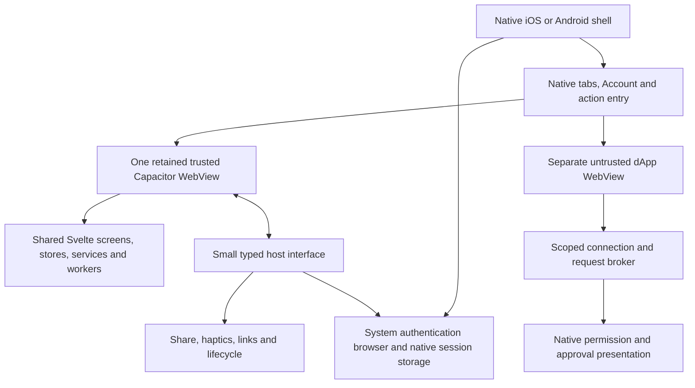

This spec follows the workflow defined in `docs/ai/spec-driven-development/workflow.md`.

# Shared web wallet with native navigation for iOS and Android

**Status:** Shared Wallet/Token/Activity routes and data/auth workers integrated into iOS Capacitor; renewal, release gates and Android incomplete.
**Updated:** 2026-10-27. The user authorized merging main, adopting/updating
Capacitor and preparing the shared web/native apps. Capacitor 8.5.3 core/CLI/iOS
are now pinned. The follow-up code review request authorizes cleanup, commit and push;
audit deployment and transaction execution remain outside this review.
Android and shared authenticated-runtime acceptance gates remain open.

## Current implementation

Main was merged through release 2.6.3 (`cb4863433`), merge HEAD `9946d6b9b`.
The only active app is `mobile/capacitor/`; preserve the installed phone's signing,
bundle and Keychain identity. Installing the app does not deploy the audit site.

The iOS package now builds the normal Svelte route tree, auth store, Loaders,
chain schedulers and workers. Wallet, Token and Activity use their real web pages.
Native owns tabs, Account, II/Keychain and isolated Explore. Search opens the normal
token filter. The separate `routes/mobile/`, snapshot props, `NativePreview*` screens
and preview portfolio/history services were removed. Browser authentication still
uses AuthClient/IDB; mobile adds an in-memory identity source behind the same
provider, including bounded independent worker keys.

This is still an audit preview. Five-minute child expiry logs out; automatic
renewal, Android, II review of the delegation trust model and financial execution
are not complete. See the [authentication review](../../../../mobile/capacitor/docs/authentication-review.md)
for the exact SDK comparison and callback deployment dependency.
See [session boundary](../../../../mobile/capacitor/docs/session-boundary.md) for
ownership and [handoff](./2026-10-27-feat-mobile-shared-web-native-navigation/handoff.md)
for verification. Earlier comparison-app retention instructions are superseded;
do not restore the old Swift wallet or merge the historical Capacitor POC wholesale.

## Evidence: what already exists

Before the implementation/main merge, the inspected iOS worktree was
`codex/ios-native-m1`, at HEAD
`bdd3b822ed167df0b8c29989c3d4c7f94e36eb45`, **with substantial uncommitted work**.
HEAD alone does not contain the current hybrid implementation. Preserve those
files and inspect the working tree before starting a migration.

The other source is draft [PR #13512: native Android and iOS POC](https://github.com/dfinity/oisy-wallet/pull/13512),
branch `claude/mobile-app-architecture-1d1cde`, inspected at
`6f3eae46807029453a9eeb7f36084c95b1cd711f`. It was open and unmerged when inspected.
Read its files with `git show`; do not switch the active checkout. Older prose in
that branch does not always describe its later redirect implementation.

| Area            | Existing Capacitor POC                                                               | Existing iOS/hybrid preview                                                                         | Proposed reuse                                                                    |
| --------------- | ------------------------------------------------------------------------------------ | --------------------------------------------------------------------------------------------------- | --------------------------------------------------------------------------------- |
| Packaging       | Capacitor 7.4.4; Android Gradle and iOS/CocoaPods projects; static Svelte build      | Swift 6, XcodeGen and bundled web assets                                                            | Selectively reuse packaging concepts; prove a compatible pinned Capacitor version |
| Navigation      | Web application inside a native container                                            | Swift Wallet, Activity, Browser and Search tabs; custom Account                                     | Preserve native navigation intent on both platforms                               |
| Wallet UI       | Ordinary web application                                                             | Actual OISY Header, Hero, Assets and token components through a preview composition                 | Shared Svelte feature screens with explicit host configuration                    |
| Data lifecycle  | AuthClient storage integration intended to reuse ordinary stores/workers             | Separate preview balance/history orchestration reuses chain APIs                                    | Converge on the normal frontend lifecycle rather than grow two data paths         |
| Authentication  | System-browser redirects; JS-generated session key persisted in AuthClient IndexedDB | System authentication, native Keychain session, five-minute child delegation to trusted web runtime | Keep working iOS ownership while validating a common session interface            |
| Browser         | Native signer integration is feature-disabled                                        | Separate dApp WebView, Uniswap/1inch discovery, scoped Sepolia connection/reads                     | Retain isolation; implement the equivalent Android host                           |
| Device evidence | Configuration and auth implementation exist; this research did not run them          | Physical iPhone sign-in and real ICP balance were confirmed by the user                             | Require independent iOS and Android evidence before declaring parity              |

### Capacitor files worth extracting

All paths in this subsection refer to the pinned POC revision, not the current
working tree. Start with its [mobile README](https://github.com/dfinity/oisy-wallet/blob/6f3eae46807029453a9eeb7f36084c95b1cd711f/mobile/README.md).

- `mobile/capacitor.config.ts`, `mobile/package.json`, `mobile/android/`,
  `mobile/ios/App/`: build and native project reference. The POC uses App 7.1.0,
  Browser 7.0.3 and Capacitor core/platform packages 7.4.4.
- `src/frontend/src/lib/services/auth-mobile.services.ts`,
  `auth-mobile-bridge.services.ts`, `utils/auth-mobile.utils.ts` and their tests:
  callback parsing, auth-client recreation and store synchronization reference.
- `src/frontend/src/routes/(public)/mobile-auth/+page@.svelte` and
  `(public)/signer-callback/+page@.svelte`: canonical-origin authentication routes.
  The default transport now uses II redirects; the bridge remains a fallback.
- `src/frontend/static/.well-known/`: Apple association, Android asset links and
  II callback configuration. Presence in Git does not prove production deployment.
- `.github/workflows/mobile-build.yml`: Android and simulator build reference.
  Editing workflows or build scripts still requires repository approval.

Do not copy these POC assumptions unchanged:

1. `iosScheme: 'https'` conflicts with the supported iOS scheme configuration.
   Validate the pinned runtime's behavior and use a supported local origin; do not
   assume the POC's comment proves the configuration works. Capacitor documents
   `capacitor` as the default iOS scheme and disallows `http`/`https` there.
   [Configuration reference](https://capacitorjs.com/docs/config).
2. The auth implementation loses its in-memory redirect state when the web process
   restarts and then skips that comparison. A custom-scheme fallback also lacks
   the same state check. Preserve pending-request binding across a cold start;
   reject mismatched, expired, replayed and superseded responses.
3. Matching the delegated public key and checking expiry do not establish that
   every required cryptographic verification is complete. Review root signatures,
   delegation constraints and intended identity before release.
4. Its bundle identifier, Apple team/domain association and Android debug signing
   fingerprint are examples from that POC, not the release configuration for this app.
5. Buy and native signer capabilities are disabled. A packaged website is not
   evidence that mobile payments, redirects or dApp transaction execution work.

### Current implementation anchors

These local files are the migration starting points, not parallel features to
reimplement:

- [ShellViewController.swift](../../../../mobile/capacitor/ios/App/App/ShellViewController.swift)
  and [OisyHostPlugin.swift](../../../../mobile/capacitor/ios/App/App/OisyHostPlugin.swift):
  retained wallet runtime, fixed-destination bridge and native screen ownership.
- [WebDelegation.swift](../../../../mobile/capacitor/ios/App/App/Auth/WebDelegation.swift):
  short-lived delegation without exporting the native private key.
- [Wallet route](../../../../src/frontend/src/routes/%28app%29/+page.svelte),
  [Token route](../../../../src/frontend/src/routes/%28app%29/transactions/+page.svelte)
  and [Activity route](../../../../src/frontend/src/routes/%28app%29/activity/+page.svelte):
  normal feature pages, reused directly by the mobile build.
- [Mobile runtime](../../../../src/frontend/src/lib/services/mobile-runtime.services.ts)
  and [worker session adapter](../../../../src/frontend/src/lib/services/mobile-worker-session.services.ts):
  native identity installation and bounded worker delegation; no portfolio/history pipeline.
- [App layout](../../../../src/frontend/src/routes/%28app%29/+layout.svelte),
  [Loaders](../../../../src/frontend/src/lib/components/loaders/Loaders.svelte),
  [AuthClient provider](../../../../src/frontend/src/lib/providers/auth-client.providers.ts)
  and [auth store](../../../../src/frontend/src/lib/stores/auth.store.ts):
  shared shell, session and worker lifecycle; the browser retains its existing AuthClient path.

The current iOS build uses the normal enabled-token universe, chain balances,
prices and history sources. It no longer has a separate seven-asset catalog or
20-transaction adapter. Token management and preferences use the shared frontend;
physical funded-account validation is still required for this new integration.
Saved contacts remain read-only. Financial execution, automatic child renewal,
Android and release gates remain incomplete; the handoff owns verification evidence.

## Target ownership

Capacitor replaces generic container, asset delivery and plugin plumbing where it
fits. It does not replace the product shell or automatically isolate an untrusted
website. Never load a dApp in the bridge-enabled wallet runtime.

On iOS, evaluate a retained `CAPBridgeViewController` inside the existing native
hierarchy; customization is an officially supported mechanism.
[iOS view controller documentation](https://capacitorjs.com/docs/ios/viewcontroller).
On Android, start from the POC's native host and add native navigation around its
bridge view. Prove lifecycle and view ownership with the chosen runtime before
committing to a custom fragment/Compose wrapper. Native plugins have supported
registration hooks; they are not an automatic cross-platform navigation system.
[Android native integration](https://capacitorjs.com/docs/android/custom-code).

### Screen and feature ownership

| Surface                                     | Rendered by                              | Shared source / platform responsibility                                                                    |
| ------------------------------------------- | ---------------------------------------- | ---------------------------------------------------------------------------------------------------------- |
| Launch and sign-in entry                    | Native                                   | OISY mark, system splash, accessible reduced-motion transition; system browser for II                      |
| Root tabs and navigation controls           | Native                                   | iOS system controls; Android native equivalents with matching destinations, platform-appropriate behavior  |
| Wallet balance, groups and assets           | Web                                      | Existing Hero, Assets, TokensList and TokenGroupCard; header collapse stays with the scrolling web content |
| Token detail, history and transaction sheet | Web                                      | Existing TokenModalContent, AllTransactionsList, chain detail views and history services                   |
| Search                                      | Web, opened by a native control          | One token/action search; no duplicate Wallet search field                                                  |
| Actions                                     | Web sheet, opened by native or web entry | One shared action registry; availability, labels and route targets have one owner                          |
| Receive                                     | Web                                      | Existing address-format, QR, copy and receive components; optional native share                            |
| Manage/import tokens                        | Web after integration                    | Existing ManageTokensModal/ManageTokens and validation/save flows; canonical token identity                |
| Send, Swap, Buy                             | Web after separate execution gates       | Existing review/wizard logic; system redirects and native consent only where required                      |
| Account landing                             | Small native screen                      | Identity/session state, appearance/device controls, connected apps, links into shared account screens      |
| Contacts and general preferences            | Web                                      | Existing OISY address book and preference stores; display saved contacts first                             |
| Browser discovery and toolbar               | Native                                   | Retain Browser as a first-class destination; Uniswap and 1inch entries                                     |
| External dApp content                       | Separate untrusted WebView               | No wallet DOM, AuthClient storage, session keys or Capacitor plugins exposed                               |
| Other product areas, including NFTs         | Shared web candidates                    | Inventory and enable individually; not assumed functional because the site supports them                   |

Use an ordinary shared web Actions sheet first. A native sheet container is an
optional later enhancement only if it can host the same view without a second
runtime, duplicated action definitions or nested scrolling. Do not write separate
Swift and Kotlin transaction forms.

### Navigation contract

- Keep Wallet, Activity and Browser root destinations, with a trailing Search
  entry on iOS and an equivalent accessible native entry on Android. Account opens
  from the profile control. A prominent native Actions button may open the common
  sheet; it must not turn into a fifth competing navigation hierarchy.
- Native owns the selected root and presentation of native screens. Web owns
  token/detail routes, filters, scroll positions and web sheets. Exchange typed
  destinations and route state, not arbitrary URLs or executable JavaScript.
- Keep one trusted runtime mounted while switching Wallet/Activity/Search. When
  Browser or Account covers it, retain it without recreating services or listeners.
  Restore each root's meaningful state; reselecting a tab has a documented behavior.
- Back first dismisses the active presentation, then pops the current feature's
  route, then leaves a native screen. At a root, follow platform behavior. Android
  system Back, iOS back controls and swipe gestures must use the same ownership
  state; they must not independently pop both native and web histories.
- Fullscreen means content fills the available area with deliberate system-bar
  treatment. No generic back/refresh chrome above Wallet; browser controls belong
  to Browser. Apply safe-area/keyboard insets exactly once and prevent empty
  overscroll beyond content without breaking lists, focus or accessible text size.
- Prefer one scroll owner per screen. Keep the balance/header collapse in shared
  web UI so native code does not maintain a second copy of portfolio values.

## Changes needed in the primary frontend

1. Separate the desktop/web shell from feature content. Compose the same feature
   views in web and embedded layouts; keep the normal website as the default.
   Use a small typed host configuration for navigation ownership, available
   capabilities and presentation variants. Avoid scattered platform/user-agent
   conditionals and CSS that merely conceals functional duplicate navigation.
2. Give session installation, renewal, logout and worker restart one lifecycle.
   Extend the existing AuthClient provider boundary rather than creating a third
   auth store. Both web and mobile should feed the same balance/history services.
3. Move popup-, browser- and device-specific operations behind narrow adapters:
   authentication, external links, sharing, optional haptics and lifecycle events.
   Ordinary web implementations continue working without Capacitor imports in
   feature components. Add interfaces only for actual duplicated boundaries.
4. Keep token identity, amount formatting, network validation, persistence and
   transaction review in shared code. Customization may change chrome, spacing,
   available actions and modal presentation; it must not fork business rules.
5. Retire preview snapshot orchestration only after shared stores and workers pass
   parity checks. Delete replaced Swift portfolio/history/import UI and bindings
   in a separate cleanup change, leaving authentication and Browser ownership intact.

Do not reuse the entire desktop layout in a constrained WebView and then patch
around it indefinitely. Likewise, do not create another independently maintained
mobile wallet page that only shares icons and token rows.

## Session, trust and lifecycle requirements

The recommended initial model preserves the native parent session on iOS and
grants a short-lived child session to the trusted wallet runtime. Validate an
equivalent Android implementation and the normal web workers' expectations in M0.
Capacitor does not supply this identity model automatically. The POC's persistent
JS-key model is an alternative requiring a deliberate security decision, not a
drop-in replacement for Keychain ownership.

- Never export the current native private key to JavaScript. Android needs a
  documented Keystore-backed storage/signing design; verify algorithm support and
  key wrapping rather than assuming every session key can be hardware-backed.
- Preserve the canonical II derivation origin and environment. Compare principal,
  addresses and balances against the same audit website account; production and
  audit identity must never be silently substituted.
- Bind callbacks to the outstanding attempt, expected key, origin, expiration and
  replay state, including process death and concurrent attempts. Validate required
  signatures/constraints. Authentication remains in a system browser, outside the
  wallet and dApp WebViews.
- A child delegation can authorize updates; it is **not cryptographically read-only**
  merely because the preview hides Send. Keep untrusted content outside that trust
  boundary and review delegation scope and app capabilities before execution.
- One session generation owns clients, workers and pending requests. On renewal,
  rebuild or refresh dependent clients once; ignore stale-generation responses.
  On expiry/logout, cancel work, clear private rendered state and permitted caches,
  disconnect Browser permissions as appropriate, and restore a consistent sign-in UI.
- Persist ordinary preferences with one owner. Decide sensitive web storage and
  data-retention rules explicitly; the current nonpersistent WebView and the POC's
  IndexedDB persistence are materially different. Never log keys, callback payloads
  or wallet data to diagnose lifecycle issues.
- Expose a minimal versioned host interface with validated arguments, active
  runtime/frame checks and capability negotiation. Deny unknown operations. Its
  existence in JavaScript is not evidence of a trusted caller.
- Native haptics are optional feedback for meaningful actions, degrade cleanly on
  web and follow accessibility/device settings. Sounds remain optional and off by
  default; no mandatory audio dependency is needed for this migration.

Keep the current dApp connection/read scope while changing containers. Injected
EIP-1193/EIP-6963 support and WalletConnect are separate transports; Capacitor adds
neither automatically. Signing/broadcast requires a separately reviewed flow with
origin, account, network, approval and rejection handling on both platforms.

## Packaging and maintenance

Build a versioned static bundle from the same frontend source and package it with
each app. Both shells consume that bundle and a compatible bridge-contract version.
The website can deploy separately; shared source does not mean a live website
change silently replaces the installed wallet. Capacitor's `server.url` option is
documented for live reload, not the proposed production delivery mechanism.
[Configuration reference](https://capacitorjs.com/docs/config).

Use M0 to compare the POC's pinned 7.4.4 with a supported current Capacitor version.
Do not mechanically mix major versions or migrate CocoaPods/SPM at the same time
as authentication. Verify Swift 6 strict-concurrency integration and the project's
existing SDK. The explicit implementation request authorized the core/CLI/iOS packages; optional plugins still require scoped approval.

Keep one native build configuration owner per platform. The existing iOS project
is generated by `project.yml`; do not let XcodeGen and Capacitor overwrite each
other's project/resource changes. Prove the chosen integration in an isolated
target or sibling experiment before changing the installed app's target. Reuse the
Android skeleton selectively, with a single Gradle project owner. No existing app
directory needs to be moved to run the experiment.

Start in this repository to simplify shared-code changes. A future shell-only
repository should consume a versioned frontend artifact and bridge contract, not
a copied Svelte tree. A small shared contract does not require sharing native UI
code between Swift and Kotlin.

## Milestones and exit criteria

| Milestone                               | Deliverable                                                                                                                     | Required evidence before moving on                                                                                                                                                                 |
| --------------------------------------- | ------------------------------------------------------------------------------------------------------------------------------- | -------------------------------------------------------------------------------------------------------------------------------------------------------------------------------------------------- |
| M0 — Compatibility and session spike    | Pinned runtime proposal; native host on both platforms; one shared mock Wallet → token → back slice; session integration design | iOS simulator and Android emulator launch; one runtime across root changes; Back/keyboard/insets work; actual toolchain versions recorded; dependency and custody decisions recorded               |
| M1 — Authenticated shared runtime       | System sign-in and existing session restoration; common stores/workers for real read-only balances                              | Physical iPhone and Android device checks: same audit principal/addresses/known balances; warm/cold callback, cancel, expiry, renewal, logout and relaunch; no private-key export or stale results |
| M2 — Shared wallet coverage             | Wallet, token, Activity, Search, Actions, Receive, Contacts and persistent preferences on both platforms                        | Feature/source inventory, light/dark and large-text checks; unavailable/offline states; same frontend behavior on the normal website; no duplicate data pipelines for migrated reads               |
| M3 — Management and execution readiness | Shared token management/import persistence; review of Send/Swap/Buy integration                                                 | Import/save/cancel/network validation checks first; any transaction execution requires separately approved testnet scope and its own acceptance evidence; mainnet stays gated                      |
| M4 — Browser parity and cleanup         | Android isolated Browser matches current iOS connection/read scope; remove superseded preview code after parity                 | Wrong-origin/frame requests denied; no trusted bridge/storage in dApps; account/network changes invalidate permissions; ordinary web regression checks; release checklist remains explicit         |

M0 is intentionally small. A successful container launch alone is insufficient to
choose the architecture: native view lifetime and common auth/worker integration
are the two highest-risk maintenance assumptions. If either needs extensive
framework patching, keep the working iOS host and reassess the Android container
against the same shared frontend contract before proceeding.

## Acceptance and verification

- [ ] The same shared feature implementation powers website, iOS and Android;
      documented presentation variants do not duplicate business logic.
- [ ] Tabs, Account entry and platform Back are real native controls. No second
      web tab bar, generic Wallet browser toolbar or duplicate search is visible.
- [ ] Switching roots and opening/closing Browser does not create additional wallet
      WebViews, session owners, worker sets or repeated listener registrations.
- [ ] Wallet → token → transaction → back and Search → token → back retain expected
      state; Actions opens once; Account → Contacts returns predictably.
- [ ] Missing prices/history/balances show unavailable or retry states, never
      invented zero values or mock live balances. Token IDs include chain/ledger
      identity, including BTC versus ckBTC and ETH versus ckETH.
- [ ] Authentication tests cover cold starts, process recreation, replay, wrong
      state/key, expiry, logout, renewal and switching identities. Fresh-account
      onboarding and root-signature verification are explicit release gates.
- [ ] iOS and Android isolate dApps from wallet storage and native plugins; existing
      iOS Browser limitations remain visible rather than silently enabling writes.
- [ ] Light/dark, small screens, large text, VoiceOver/TalkBack, reduced motion,
      keyboard focus and offline/retry behavior are checked on both platforms.
- [ ] Build records identify web revision, native revision, runtime/contract version
      and environment. Incompatible bundles fail with a recoverable update message.

Use existing frontend unit/component tests and the repository's normal quality
gates for changed code. Add focused bridge/session lifecycle tests, iOS native
tests and Android native instrumentation for new boundaries. Do not add Playwright
specs by default; the repository's E2E restriction still applies. Run one heavy
build at a time on this Mac. Capture cold launch, tab-switch and memory baselines
before optimizing; do not claim performance parity without measurements.

No app build or device test was executed for this documentation-only spec. Existing
iOS phone evidence cannot be reused as Android or Capacitor migration evidence.

## Continue implementation

The handoff contains the first bounded task and the human/tooling checklist, while
this document remains the source of architecture and acceptance requirements.
Source: [Mobile migration handoff](./2026-10-27-feat-mobile-shared-web-native-navigation/handoff.md)

## Dependencies

| Document                                                       | Purpose                                                          |
| -------------------------------------------------------------- | ---------------------------------------------------------------- |
| [Repository instructions](../../../../AGENTS.md)               | Change boundaries, dependency approval and review rules          |
| [Spec workflow](../workflow.md)                                | Build/review process and unresolved-item classification          |
| [Frontend guide](../../frontend/README.md)                     | Existing frontend conventions and linked implementation guidance |
| [Capacitor entrypoint](../../../../mobile/capacitor/README.md) | Current app, setup, testing and owning documentation             |

## Related

| Document                                                     | Purpose                                              |
| ------------------------------------------------------------ | ---------------------------------------------------- |
| [Original iOS MVP spec](./2026-10-22-feat-ios-native-mvp.md) | Earlier iOS-only experiment and historical decisions |

## Open questions (facts to confirm)

| ID  | Question                                                                                                                          | Owner / evidence needed                                                                      |
| --- | --------------------------------------------------------------------------------------------------------------------------------- | -------------------------------------------------------------------------------------------- |
| Q1  | Which current Capacitor version fits the existing Swift 6/XcodeGen/SDK setup and Android host without framework patches?          | Engineering; M0 compile and lifecycle evidence, exact dependency pins                        |
| Q2  | Can normal AuthClient consumers and web workers use renewed native-issued child sessions without a separate mobile data pipeline? | Frontend/auth engineering; read and renewal spike, including IDB/process recreation behavior |
| Q3  | Which native Android storage/signing implementation supports the required session-key algorithm?                                  | Android/auth engineering; Keystore/device verification and documented fallback               |
| Q4  | Are callback domains and association files actually deployed for the intended bundle IDs and release certificates?                | Release owner; on-device Universal/App Link verification, not repository files alone         |
| Q5  | What Android SDK/JDK/emulator/device setup is available locally, and which minimum OS versions should testing cover?              | Engineering; local inventory and product device support requirements                         |
| Q6  | Which web workers, external providers and redirect flows need origin/CSP/CORS changes under packaged local origins?               | Frontend engineering; exercised read paths and provider inventory; no wildcard bypass        |

## Pending decisions (facts are clear — we just need to decide)

| ID  | Decision            | Recommendation and status                                                                                                                                              |
| --- | ------------------- | ---------------------------------------------------------------------------------------------------------------------------------------------------------------------- |
| D1  | Product ownership   | **User requirement:** iOS and Android, native navigation, most wallet content shared from the primary web frontend                                                     |
| D2  | Container adoption  | **Authorized for M0:** Capacitor 8.5.3 core/CLI/iOS; selective POC reference, no wholesale branch merge. Final adoption still depends on M0 gates                      |
| D3  | Session custody     | **Implemented preview:** native parent/child custody and shared provider/store/workers integrated on iOS; renewal and Android pending                                  |
| D4  | Actions and Account | **Proposed:** native entry controls and compact Account landing; shared web Actions sheet, Contacts and general preference screens                                     |
| D5  | Native UI tooling   | **Proposed:** retain SwiftUI/UIKit; choose Android native controls compatible with the host. Compose/Material additions, if needed, require normal dependency approval |
| D6  | Delivery            | **Implemented for M0:** bundled versioned frontend in the same repository; no remote live reload or copied frontend tree                                               |
