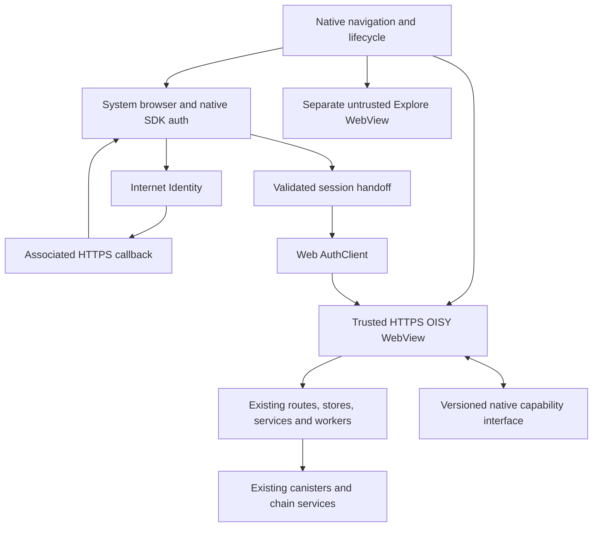

This spec follows the workflow defined in `docs/ai/spec-driven-development/workflow.md`.

# Live OISY website in a native mobile shell

**Status:** SDK sign-in is integrated and phone account continuity passed on
2026-11-06. M2 runtime detection and the live WKWebView controller are implemented
and pass local regression checks. Audit deployment, live phone acceptance, broader
M1 acceptance and II review remain open.
**Date:** 2026-11-05.
**Baseline:** `codex/ios-sdk-auth-preparation` at `4a5136c4ac`.

Move the mobile wallet from bundled web assets to the deployed OISY website.
Keep wallet features in the web application and a small native host for system
authentication, navigation, device capabilities and isolated Explore browsing.
Start with a verified native-to-web authentication handoff on audit.

2026-11-05 continuation: SDK authentication is now wired into the actual app source,
including web/worker handoff and original-deadline handling. Local validation and
real phone acceptance are in progress. Audit deployment `dee72ab616` completed;
the preview's association files are live. M2 live website delivery remains open.
See [app integration](../../../../mobile/capacitor/docs/sdk-app-integration.md).

2026-11-09 continuation: the user authorized live website delivery, preserving
native navigation, II authentication and Explore. The shared frontend now supports
runtime host detection and worker session selection without `VITE_MOBILE_SHELL`.
The user explicitly approved controller replacement and local testing. The HTTPS
bridge and integrated controller passed origin/subframe/document-isolation,
reload and process-failure checks. Shared-screen regressions, 240 focused frontend
tests, application/test type checks and repository lint pass. Detailed evidence is
in [app integration](../../../../mobile/capacitor/docs/sdk-app-integration.md#live-host-verification-on-2026-11-09).
Commit and push were approved on 2026-11-09. Audit deployment and phone installation
have not been performed for M2. See the
[live-host contract](../../../../mobile/capacitor/docs/shared-web-contract.md#live-host-2026-11-09).

## Relationship to existing work

This is the successor plan to the October Capacitor migration and SDK-auth
preparation. Those documents describe the working preview and remain its operating
instructions until replacement code passes acceptance. This plan changes the
target delivery model and selects a different session handoff; it does not claim
that either has shipped or received II security approval.

Keep the existing app, bundle/signing overrides, Keychain service and transaction
recovery records during development. Work in `mobile/capacitor/` initially; its
directory name is not a reason to move files or create a second wallet app.
Do not restore the retired native wallet. The user authorized implementation and
audit deployment preparation. Ask before pushing. The user will trigger the audit
deployment; production deployment and funded transaction tests remain separate.

## Problem and intended result

The current preview packages the real Svelte routes, but web changes reach the
phone only after rebuilding and installing its web bundle. Mobile authentication
also installs a separate in-memory identity through shared providers and worker
adapters. This increases the number of paths the team must maintain.

After migration, one web deployment supplies the wallet screens and business logic
to browsers and installed apps. Native features remain independently versioned:
a web deployment can use an existing capability, but adding a native capability
still requires a binary update. Website deployments must support older installed
hosts rather than assume a matching web/native build.

## Verified starting point

These are source and public-configuration observations from 2026-11-05, not runtime
acceptance of the proposed flow. Implementation evidence is recorded in the linked prototype README.

| Area            | Observation                                                                                                                                                                                  |
| --------------- | -------------------------------------------------------------------------------------------------------------------------------------------------------------------------------------------- |
| Mobile delivery | Capacitor 8.5.3 loads bundled assets at `capacitor://localhost`; the trusted bridge rejects remote origins                                                                                   |
| Feature reuse   | Wallet, Token, Activity, ICP/ck-token and EVM Send, and same-chain ICP/ck Swap already reuse web code; funded device acceptance remains incomplete                                           |
| Authentication  | Native Keychain parent, ephemeral web/worker credentials, fixed one-hour deadline, audit relay and custom-scheme callback                                                                    |
| Web SDK         | This branch and upstream OISY `main` declare `@icp-sdk/auth ^6.2.0`; the reviewed web SDK main source declares `11.1.0` with different storage/session APIs                                  |
| Native SDK      | User confirmed `dfinity/icp-native-sdk` **main**; reviewed revision `cc22ba56b6cbab384fcef02c8e3c8624341cc30a` exposes `SessionAware` and `SessionHandle.issueTo(publicKeyDer:)`             |
| Handoff         | Local native→web hop and public Auth 11 session primitives are implemented in an isolated harness; real sign-in remains unverified                                                           |
| Domains         | Audit serves association JSON and an II callback allowlist; its Apple file names a different app ID and lacks `webcredentials`. The corresponding production URLs return HTML                |
| External apps   | Web WalletConnect exists but its listener is excluded from the mobile build. Explore supports discovery, consented account disclosure and allowlisted Sepolia reads, not transaction signing |

The SDK source separates Rust cryptographic/agent primitives from platform-owned
session lifecycle and storage. Shared primitives do not establish compatibility
between Swift storage, web AuthClient versions and an iframe protocol. The meeting's
SDK completion estimate is not an estimate for this migration.

## Scope and ownership

| Concern                                                                            | Target owner                                                                                          |
| ---------------------------------------------------------------------------------- | ----------------------------------------------------------------------------------------------------- |
| Wallet, Token, Activity, Search, Notes, token management, Contacts and preferences | Existing deployed Svelte routes and components                                                        |
| Balances, prices, history, fees, quotes, approvals and execution                   | Existing web stores, services, schedulers and workers                                                 |
| Authentication ceremony and native credential storage                              | SDK-derived native auth adapter, system authentication browser and platform storage                   |
| Web authentication                                                                 | Supported web AuthClient integration consuming an approved session handoff                            |
| Root navigation                                                                    | Native Wallet, Activity, Explore and More; shared web router owns feature destinations and form state |
| More and Account                                                                   | Preserve existing entry points; feature content remains web-owned, device controls native             |
| Back, pull-to-refresh, haptics, share and camera                                   | Narrow native capabilities with ordinary browser fallbacks                                            |
| External dApps                                                                     | Separate Explore WebView and permission broker; no trusted-wallet bridge or credentials               |
| Incoming WalletConnect links                                                       | Native dispatch into the existing web WalletConnect lifecycle and review UI                           |

iOS is the first deliverable. Android must use the same versioned web contract and
auth semantics, with its own system-browser, app-link and lifecycle implementation.
An iOS pass does not establish Android parity.

Changing delivery does not enable every feature already present on the website.
Retain the preview's tested action/provider gates until each platform-dependent
flow passes its acceptance checks. Existing UI gates are not cryptographic limits
on the web identity's signing authority.

## Target architecture

Use a retained `WKWebView` host for iOS live content. Replace the Capacitor bridge
with the smallest typed transport that preserves the existing checks. Do not
ship Capacitor's development `server.url` switch as the final architecture; its
[configuration documentation](https://capacitorjs.com/docs/config) describes that
option as intended for live reload, not production.

### Authentication handoff

The candidate flow, trust boundary, lifecycle and proof requirements are specified
separately because they must be agreed before broader host migration.
Source: [Native-to-web authentication handoff](./2026-11-05-feat-mobile-live-web-sdk-auth/auth-handoff.md)

### M1 implementation evidence

The [prototype README](../../../../mobile/capacitor/auth-handoff/README.md) owns
pinned versions, local tests, build commands, deployment steps and remaining checks.
II clarified that a single native app can add a local delegation hop; experimental
app-suite session re-issuance is not needed. This changes step 5 of the original
handoff proposal. It does not establish security approval or real-device acceptance.

### Domain and app identity

Prove the flow first on `audit.oisy.com`, with explicit audit derivation origin and
the existing `/signer-callback` allowlisted URL. Production uses its own explicit
configuration and requires same-account proof against the production web wallet.
Never infer that audit and production derive the same principal.

The deployment owner must serve valid JSON at the exact HTTPS well-known paths:

- `apple-app-site-association`: correct team/application identifiers, callback
  `applinks` rules and `webcredentials` registration. Match both entitlements in
  the signed binary and provisioning profile, not only Xcode settings.
- `ii-auth-callbacks`: the exact callback allowed by the chosen II transport.
- `assetlinks.json` for Android: the actual package and appropriate signing
  certificate fingerprints, matched by verified App Links in the manifest.

Preserve existing registrations. Do not redirect these resources or let the SPA
fallback serve HTML. Preserve the current audit relay and identify its deployed
source before modifying it. Remove dependence on the `oisy://` auth relay only
after the new HTTPS callback passes real-device tests. II auth links and
WalletConnect links are separate contracts; one does not settle the other.

Use [Apple HTTPS callbacks](<https://developer.apple.com/documentation/authenticationservices/aswebauthenticationsession/callback/https(host:path:)>),
[associated domains](https://developer.apple.com/documentation/xcode/supporting-associated-domains)
and [Android App Link verification](https://developer.android.com/training/app-links/verify-applinks).
The SDK's default HTTPS auth presenter needs iOS 17.4 or later; verify the actual
deployment target and device behavior. Simulator fixtures do not prove association.

### Runtime web/native contract

Replace build-time `MOBILE_SHELL` choices with a negotiated runtime host contract
where necessary. The normal website must retain its browser navigation and auth
when no compatible native host is present. Feature code consumes shared adapters,
not direct WebKit/Capacitor calls or user-agent checks.

The handshake reports protocol version, host version and supported capabilities;
native binds it to the current document and session generation. Use separate,
bounded schemas for auth import, route state, overlay state, refresh completion,
device requests, operation recovery and incoming links. No generic JavaScript,
arbitrary fetch or arbitrary signing method is added.

Native validates the exact configured HTTPS origin, main frame and current
document on every privileged request. Navigation to another origin invalidates
the trusted channel and never carries a session into Explore. Subframes have no
general native privileges. Any dedicated auth iframe gets only the reviewed
handoff protocol described in the child document.

Preserve the current navigation behavior: committed routes determine selected tabs;
Token returns to its actual Wallet/Search parent; root tabs do not create cross-tab
Back history; blocking overlays hide native controls and suspend gestures. Keep
scroll restoration, correct Back snapshots, visible refresh progress and haptics.
Handle keyboard/safe-area changes, accessibility text sizes and Reduce Motion.

### Live web delivery and recovery

The trusted WebView loads one configured OISY environment over HTTPS. Wallet pages
use its normal providers, CSP and worker lifecycle. Verify RPC allowlists and
worker requests from the real HTTPS origin; do not assume prior local-origin
failures disappear automatically or proxy around provider restrictions.

Keep a small native loading/error view with Retry for initial load failure and
WebKit process termination. A network error does not mean an expired session. Do
not replace the website with an old signed-in bundled wallet when the network is
unavailable. Cached assets must remain compatible with the active host contract;
do not force an application reload while a transaction is pending.

Website and host expose non-sensitive version identifiers for diagnostics. Additive
capabilities are optional. A breaking contract needs an overlap period for the
previous supported host; an unsupported host shows an explicit update state before
auth import or execution. Never silently switch the user's environment.

### Financial operations and Explore

Preserve the existing durable, principal-bound operation records, CAS checks,
reconciliation and unknown-outcome locks through reload, upgrade and expiry.
Never delete or replay an unresolved Send/Swap record to complete auth migration.
Retire native recovery storage only after an equivalent durable owner and data
migration have been tested. Keep its narrow interface if the web SDK does not
replace it.

Explore remains isolated and keeps its current connection/read-only scope during
host migration. Injected wallet discovery is not evidence that Uniswap or 1inch
can execute trades. Supporting their signing requests is separate work using
existing wallet validation/review logic, not a new Swift transaction engine.

### WalletConnect

Reuse the web WalletKit provider, session handlers, chain validation and approval
screens. Native receives supported mobile links and delivers them after the web
runtime is ready. Validate payload size/type and deduplicate delivery across cold
start, resume and repeated callbacks. Pairing URIs must not enter logs, analytics
or general navigation URLs; expire or clear unprocessed requests explicitly.

On II expiry, require sign-in before a pending signing request can proceed, then
revalidate account, chain, request expiry and user consent. A WalletConnect session
does not confer an II identity. Define disconnect/account-switch behavior and
test websocket recovery after backgrounding. Return only through validated link
flows; a scanned QR must not trigger an arbitrary automatic redirect.

Start with one supported EVM connection and request-review flow. Broader namespaces
and execution require their own parity tests. Mobile redirect metadata and wallet
listing configuration are part of this work. Do not require a second native
WalletConnect implementation unless the web client demonstrably cannot meet the
lifecycle requirements. See [mobile linking](https://docs.walletconnect.com/wallets/ios/mobile-linking)
and [web WalletKit usage](https://docs.walletconnect.com/wallets/web/usage).

## Delivery milestones

Each milestone should land as a small reviewable change. Runtime and financial
acceptance below are requirements, not tests already performed.

| Milestone                                          | Deliverable                                                                                                                                                                                           | Exit evidence                                                                                                                                                                          |
| -------------------------------------------------- | ----------------------------------------------------------------------------------------------------------------------------------------------------------------------------------------------------- | -------------------------------------------------------------------------------------------------------------------------------------------------------------------------------------- |
| **M1 — Prove SDK auth handoff on audit**           | Pin the confirmed native main revision; select compatible web SDK/import APIs; reproduce the native build; prepare and verify audit association; authenticate through the public web SDK session APIs | II-reviewed credential model, real-device callback, same principal and accounts, signed nonfinancial request, reload/restore, explicit logout, fixed expiry and negative handoff tests |
| **M2 — Load the live website**                     | Retained HTTPS wallet WebView, runtime capability adapter, normal web auth/data/worker lifecycle, local loading/error UI                                                                              | Wallet/Token/Activity and existing preview actions work; a web-only deploy changes the installed app; desktop browser remains correct; provider and failure checks pass                |
| **M3 — Preserve native interactions and recovery** | Existing navigation/More/Account, shared modal rules, Back, refresh, haptics and operation journal on the new host                                                                                    | Light/dark and accessibility checks; correct gesture destinations; no duplicate overlays or refreshes; process/reload/logout recovery never resubmits unknown operations               |
| **M4 — Enable mobile WalletConnect**               | Native links routed to shared web sessions/review; one supported EVM path                                                                                                                             | Same-device and QR pairing, cold/warm start, rejection, cancellation, auth expiry, account mismatch, duplicate links and return navigation tested                                      |
| **M5 — Remove replaced code and prepare release**  | Delete replaced Capacitor packaging/auth glue and unused dependencies; retain required native capabilities; update agent guides and product description                                               | Dependency/secret checks, supported old-host/new-web and rollback matrix, device acceptance and reviewed release limits                                                                |
| **M6 — Android parity**                            | Android host using the same contract and approved auth model                                                                                                                                          | Independent App Links, auth, lifecycle, navigation, WalletConnect and recovery evidence; no copied wallet business logic                                                               |

M1 is a go/no-go check for the broader migration. A focused harness is acceptable;
a second permanent wallet implementation is not. Do not delete the working path
or silently invent an auth protocol if M1 fails. Record the specific unsupported
API, missing deployment or verification failure and bring that evidence to II.

## Validation and rollout

| Area              | Required checks                                                                                                                             |
| ----------------- | ------------------------------------------------------------------------------------------------------------------------------------------- |
| Auth              | Child document's test matrix; same-account proof on device; no credential values in artifacts                                               |
| Web compatibility | Normal browser and trusted host; supported older binary with new web; previous compatible web with new binary; unsupported-version behavior |
| Features          | Wallet totals/quantities, token and Activity history, price/fee/quote loading, Notes and settings proof requirements, retained action gates |
| Interaction       | Simulator light/dark, Dynamic Type/VoiceOver, Reduce Motion, safe areas, keyboard, cancellation, Back and refresh                           |
| Recovery          | Offline foreground, WebKit termination, logout during each async stage, unresolved EVM/ICPSwap operations across app/web updates            |
| Boundaries        | Wrong origin/frame/path, redirects, stale documents, malformed/oversized bridge input, replay and unexpected capability requests            |
| External apps     | Explore cannot reach the trusted bridge/storage; WalletConnect requests use real shared review and supported namespaces                     |

Use existing frontend/native test locations and the repository quality gates.
Do not add Playwright specs under `e2e/` without authorization. Mocked signing and
network-blocked simulator tests precede device tests. Real passkeys require user
interaction; funded sends, approvals and swaps require explicit authorization.

Deploy compatible web support to audit before enabling the new host. Keep the
working preview available until acceptance. Roll back a website only to a revision
compatible with the installed host; a rollback must not downgrade credential
validation or replay an operation. An incompatible session can require fresh
sign-in; preserve preferences and recovery records. Production deployment and
App Store distribution require separate release approval and review of supported
features. Record evidence and limitations without claiming a full security audit.

## Documentation and code ownership

Start from [AuthClientProvider](../../../../src/frontend/src/lib/providers/auth-client.providers.ts),
[MobileHost](../../../../src/frontend/src/lib/components/core/MobileHost.svelte),
[mobile runtime](../../../../src/frontend/src/lib/services/mobile-runtime.services.ts),
[worker session adapter](../../../../src/frontend/src/lib/services/mobile-worker-session.services.ts),
[trusted WebView](../../../../mobile/capacitor/ios/App/App/TrustedWalletViewController.swift),
[native shell](../../../../mobile/capacitor/ios/App/App/ShellViewController.swift)
and [WalletConnect provider](../../../../src/frontend/src/lib/providers/wallet-connect.providers.ts).

Implementation must update the compatibility guide, mobile AGENTS/README, session
guide, feature coverage and `docs/ai/PRODUCT.md` alongside actual behavior changes.
Keep one canonical contract describing native capabilities, supported host versions,
route ownership and required checks for future web changes. The current guides
must continue to distinguish the installed baseline from the isolated prototype.

## Dependencies

| Document                                                                               | Purpose                                                                   |
| -------------------------------------------------------------------------------------- | ------------------------------------------------------------------------- |
| [Shared web/mobile contract](../../../../mobile/capacitor/docs/shared-web-contract.md) | Current route, bridge, worker and durable-operation invariants            |
| [Current session boundary](../../../../mobile/capacitor/docs/session-boundary.md)      | Existing credential ownership, deadline and backend II-proof requirements |
| [Mobile feature coverage](../../../../mobile/capacitor/docs/feature-parity.md)         | Scope and platform gaps to preserve during migration                      |

## Related

| Document                                                                                       | Purpose                                                                                                      |
| ---------------------------------------------------------------------------------------------- | ------------------------------------------------------------------------------------------------------------ |
| [Capacitor migration spec](./2026-10-27-feat-mobile-shared-web-native-navigation.md)           | Earlier architecture and implementation history                                                              |
| [SDK migration preparation](../../../../mobile/capacitor/docs/sdk-auth-migration.md)           | Prior build/distribution evidence and domain checker; its earlier handoff proposal is not this plan's target |
| [Existing migration handoff](./2026-10-27-feat-mobile-shared-web-native-navigation/handoff.md) | Device and regression evidence for the working preview                                                       |

## Open questions — facts to confirm

- **Q1, II/SDK owners, blocks acceptance:** Review the local-hop patch and the public
  Auth 11.1.0 `SessionMinter` / `SessionIdentity` adapter. No public AuthClient import
  or reviewed iframe protocol was found; M1 does not write private storage slots.
- **Q2, II/SDK owners, blocks M1:** Prove audit account continuity, the original
  one-hour boundary and the backend's explicit II proof for allowances, profile
  updates and Notes using real credentials.
- **Q3, mobile/SDK owners:** Source builds and macOS/iOS suites now pass for the
  pinned revision. Package distribution and device build reproducibility still
  need validation; provenance and the local patch are in the prototype directory.
- **Q4, deployment/mobile owners, blocks device M1:** Deploy the prepared audit
  assets and verify the signed app/profile. Callback source was recovered from
  `claude/mobile-app-architecture-1d1cde` at
  `6f3eae46807029453a9eeb7f36084c95b1cd711f` and restored in this branch.
- **Q5, web/mobile owners, blocks M2/M4:** Establish the shared provider/worker
  integration and WalletConnect lifecycle on the live HTTPS host.

## Decisions and remaining approvals

- **D1, product/mobile — approved:** Implement the staged migration, starting with
  M1 on iOS; Android follows in M6.
- **D2, II/security/web:** Approve the web-held session authority and storage model
  once M1 resolves Q1/Q2. Recommendation: delegate to a fresh web-owned key through
  reviewed SDK APIs; never export the native private key or patch private DB slots.
- **D3, SDK/mobile:** Select vendoring versus a consumable pinned SDK package after
  Q3. Recommendation: follow the team's vendoring direction with provenance and
  minimal upstream patches; do not copy cryptographic primitives into app code.
- **D4, release owners:** Choose production bundle/package identities and the
  supported host-version overlap before rollout. Recommendation: keep audit and
  production explicit and separate; preserve the installed preview identity.
- **D5, product:** Approve WalletConnect ahead of broader Explore signing.
  Recommendation: reuse web WalletConnect first; retain Explore's current limits.
