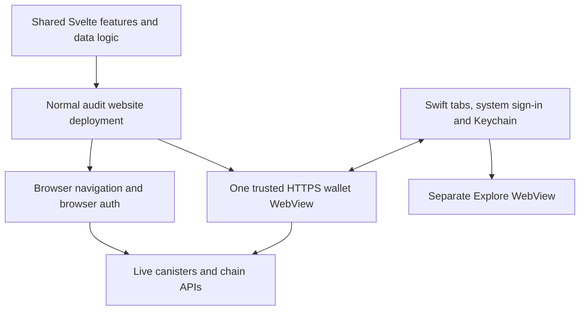

# Shared web and mobile compatibility

The website is the primary feature implementation. The iOS shell loads its deployed
Svelte routes, components, services, stores and workers over HTTPS. Read this guide
before changing shared routes/layouts, modal primitives, authentication, providers,
workers, host messages or build configuration. It defines the maintenance policy;
the feature inventory records current coverage and proposed additions.

SDK authentication is being integrated into the actual app. Before changing mobile
credentials, providers, workers or build dependencies, read
[SDK app integration](./sdk-app-integration.md). Browser Auth 6 and the private
mobile Auth 11 adapter intentionally coexist; do not flatten the SDK dependency
versions or replace the original session deadline with an app credential's expiry.

## One implementation, two hosts

### Live host (2026-11-09)

The normal website build now detects the document-start `window.__oisyHost`
transport. `mobile.constants.ts` selects mobile presentation before auth startup;
`mobile-host.providers.ts` handles transport details. Ordinary website visits
still use browser navigation and AuthClient storage. An unsupported native host
must fail startup rather than fall back to browser credentials.

Workers select mobile mode through their first `mobileSession` message and private
MessagePort, before loading an identity. They do not depend on a mobile-only Vite
build. The existing packaged-host transport remains compatible during migration.

`TrustedWalletViewController` now loads the exact origin from `app-environment.json`
in a nonpersistent WKWebView. `LiveWalletBridge` and `LiveWalletOriginPolicy` enforce
the HTTPS boundary. Real WebKit tests cover the configured origin, subframes,
stale documents, reloads and process failure. The user approved the controller
replacement and local testing. Audit deployment and phone installation completed
on 2026-11-09. The user confirmed that sign-in opens Wallet and ICP matches. See
[deployment evidence](./sdk-app-integration.md#live-host-verification-on-2026-11-09).

For the live rollout:

- Deploy the normal audit frontend with runtime-host support before installing a
  host that loads it. Keep the current audit derivation origin and Apple identity.
- Negotiate protocol v2 and required capabilities before requesting the session
  handoff. Add optional capabilities without changing existing meanings; breaking
  changes need a new protocol and an explicit unsupported-version response.
- Load new web assets on a new document or explicit safe reload. Do not force a
  reload on foregrounding, a release announcement or a version-check response
  while a transaction may be pending.
- Preserve the original session deadline and the principal-bound operation journal
  across reloads. A network failure must not erase unknown transaction outcomes.
- Treat frontend deployment access as wallet-security access. Trusted website
  code receives a signing-capable app identity; exact-origin checks do not protect
  against malicious code released on that trusted origin. The UI feature gates
  are not cryptographic restrictions on that identity.

Native code must check the exact configured origin and main frame on every call,
bind it to the current document, and reject late responses after reload or logout.
Explore keeps a separate WebView, data store and provider; it receives no wallet
host transport. The native session key never crosses this boundary.

Publishing audit updates the screens on the next wallet document load. An already
open document keeps running; the host does not replace it during Send or Swap.
Native navigation, auth and capabilities still require an app update. Roll out the
compatible website before installing this host. The audit frontend deployed on
2026-11-09 contains these runtime changes.

`app-environment.json` and `TrustedWalletViewController` own delivery. The existing
Capacitor package/config scaffold remains, but this controller does not instantiate
a Capacitor bridge or load its `webDir`. `mobile:sync:ios` updates native scaffold
and project configuration without building or copying the website. Offline shared-screen fixtures belong only
to the XCTest bundle. There is no packaged-wallet fallback. HTTP failure, an
incompatible page or WebKit process loss shows a native Retry screen. It discards
the document and its workers without erasing the session or operation journal.

## Audit callback and association deployment

The normal website build restores `/signer-callback` for the installed preview's
`oisy://auth-callback` return link. The native auth owner still validates the
request and delegation. Keep that route during SDK migration.

`build:post-process` runs `auth-handoff/prepare-audit-assets.mjs`. Only the exact
resolved domain `https://audit.oisy.com` receives the reviewed association and II
callback files. Preserve existing Apple/Android registrations; other environments
must not inherit this preview identity. Do not copy those files into global static
assets or remove the callback while a working preview depends on it. Deployment
instructions and the separate SDK harness are in the
[prototype README](../auth-handoff/README.md). The SDK host uses the associated
HTTPS callback. Keep compatibility assets for previously installed previews.

## Provider configuration

The live wallet uses the website deployment's provider configuration and HTTPS
origin. Local mobile env files no longer supply the installed wallet's API keys.
Keep values in ignored config or deployment secrets, and keep generated bundles
untracked. Client credentials remain visible in the delivered web assets;
they must not grant server administration or wallet signing authority.

Verify enabled provider reads from the configured audit HTTPS origin, including
provider domain allowlists. A successful request from `oisy.com` does not prove
audit access. Never
bypass a provider restriction through origin spoofing or a generic native proxy.
See [build setup](../README.md#build-and-run).

## Ownership

| Concern                                                                | Owner                                       | Rule                                                                               |
| ---------------------------------------------------------------------- | ------------------------------------------- | ---------------------------------------------------------------------------------- |
| Wallet/Token/Activity and other feature bodies                         | Existing web routes/components              | Reuse source; mobile layout may customize chrome, not copy business rules          |
| Amounts, token identity, balances, prices, history, fees and execution | Existing chain services/stores/workers      | No Swift balance or transaction pipeline                                           |
| Authentication entry and private native key                            | Native AuthModel/Keychain                   | System-browser II flow; native key never crosses into JS                           |
| Auth consumers and worker lifecycle                                    | Shared provider plus mobile session adapter | Use AuthClientProvider/AppWorker; no new direct AuthClient/IDB path for a feature  |
| Root controls/system presentation                                      | Native shell                                | Web reports committed location; native cannot guess detail state from a tab        |
| Feature routing, nested steps and form state                           | Shared web feature/navigation adapter       | Define Back/discard behavior once; retain state without a second wallet runtime    |
| Shared modal presentation                                              | Shared Modal API and host adapter           | Use explicit presentation props/hooks; retain the same feature content             |
| Explore apps and permissions                                           | Separate native browser/provider            | No wallet bridge, identity or storage exposed to dApps                             |
| Device-specific share, files, camera and feedback                      | Narrow host capability when needed          | Provide ordinary browser behavior; no plugin imports throughout feature components |

Keep this repository together while the integration develops. If a separate mobile
repo is required later, consume the deployed frontend and a versioned bridge
contract. Do not copy the Svelte tree. Swift/Kotlin shells may differ while feature
logic stays shared.

## Contract surfaces to change together

| Change                            | Current files / invariant                                                                                                                                                          |
| --------------------------------- | ---------------------------------------------------------------------------------------------------------------------------------------------------------------------------------- |
| Destination or query parameter    | `lib/schema/mobile-host.schema.ts`, `lib/utils/mobile-navigation.utils.ts`, `MobileHost.svelte`, native `WalletRoot` and `WalletOriginPolicy`; update both allowlists and mappings |
| Host message                      | TS schemas/services, `LiveWalletBridge`, `WalletHostCommands`, tests and build metadata; version breaking changes explicitly                                                       |
| Modal markup/styles               | `Modal`, `ContentWithToolbar`, overlay focus store and `MobileHost.svelte` presentation rules; blocking overlays hide native controls until final unmount                          |
| Safe-area/navigation geometry     | `MobileHost.svelte` and `ShellViewController.swift` currently both use an 88px navigation inset; keyboard/overlay/content must agree                                               |
| Authentication lifetime           | Web `AUTH_MAX_TIME_TO_LIVE`, native `AuthSession.duration`, callback bound and web/worker expiry checks; preserve saved deadline and shorter II expiry                             |
| Worker creation or auth consumers | `AuthClientProvider`, `_worker.services.ts`, `workers/workers.ts`, `mobile-runtime` and `mobile-worker-session` adapters; install identity before starting work                    |
| Backend II proof                  | `delegation.utils.ts` extracts the II-signed link for that proof; the full native→web→worker chain still authenticates requests                                                    |
| Build/provider configuration      | Normal website build, deployed CSP/provider configuration, native origin config and test-only fixtures; verify browser and WKWebView runtime modes                                 |

Frontend names above are under `src/frontend/src/`; native sources are under
`mobile/capacitor/ios/App/App/`. The current bridge is strict v2. Native validates
configured HTTPS origin, top frame, method, active document and session independently of JS.
Do not broaden route/method checks to arbitrary URLs, code, fetch or signing.

Existing mobile modal CSS reaches into `.modal > .wrapper.dialog`, headers,
containers and footer structure. That is a fragile dependency, not a stable public
API. When those primitives change, introduce explicit presentation data hooks/CSS
variables owned by the shared component and test the modal in WebKit.
The existing `mobilePresentation` prop should remain the feature-facing entry.

## System sheets

The optional v2 `nativeSheets` capability moves the existing trusted WKWebView
into a `UISheetPresentationController`. It does not create a second document,
reload the page, hand off another identity or serialize feature state. The shared
Svelte components still own forms, data, validation, signing and cancellation.
Explore has no access to this capability.

Accessory `Modal` dialogs (`mobilePresentation="sheet"`) and dismissible
`BottomSheetContainer` use
`nativeSheet` from `mobile-sheet.services.ts`. The adapter sends a document-bound
`sheet` command with a UUID, a fixed phase (`prepare`, `present`, `dismiss`,
`release`) and a size (`medium`, `large`). Native validates those fields through
the existing origin, main-frame, document and session boundary. No URLs, HTML,
JavaScript, credentials or form values are passed in this command.

Preparation captures the underlying screen while the web panel and its backdrop
are explicitly hidden. Hiding only the parent is insufficient: the Backdrop uses
a visibility utility that overrides inheritance. The captured image stays in
memory behind the native sheet. The same WebView then fills the
sheet, including its existing overlay focus trap. Closing freezes the departing
panel before its web outro removes it. Before release, web removes the sheet layout
attributes. Native restores the WebView and its original scroll offset under the
page image, then waits for a WebKit snapshot with `afterScreenUpdates` before
removing that cover. This lets safe-area CSS and viewport changes paint without
flashing Activity at a temporary offset. Moving to the existing parent is a no-op.
Native navigation stays blocked until release. Preparation and presentation reject
a hidden Wallet or a native flow already presented by the shell, so a delayed web
dialog cannot appear over Explore or Account. Document replacement, process
failure, expiry and logout clear the presentation and its images.

Nested web dialogs reuse the open system sheet and their existing overlay stack;
a larger nested form expands a medium sheet. A swipe requests the topmost shared
Close callback. UIKit does not dismiss unconditionally: busy state, hidden Close,
unsaved-change checks and transaction guards still apply.

Send, Swap, Contacts and other multi-step `WizardModal` flows use full-page web
presentation, with Back/Cancel controls. Notes editors also stay full-page. They
do not create a native sheet; only accessory overlays above them can do so.
Send, Swap and Contacts opt into `mobileSwipeBack` on the shared `WizardModal`.
Only their topmost full-page panel handles a rightward touch starting within 24 CSS
pixels of the left screen edge. It follows the finger above the actual parent DOM;
no screenshot, route pop, WebView reload or session handoff is needed. A completed
swipe calls the same guarded callback as the leading Back button. This closes the
flow; the existing in-form Back buttons still navigate individual wizard steps.
A cancelled swipe leaves form values and the underlying route/scroll intact.
Busy/submitting states, disabled/hidden Back controls and overlays above the page
block the gesture. Size/visibility changes cancel it. Reduce Motion removes the
settling animation. Ordinary browser modals and accessory sheets do not install
these handlers. The native token-route recognizer remains blocked while any web
page flow is open; it cannot pop the token underneath.

Receive-address QR dialogs explicitly opt into sheet presentation. Alerts retain
their existing web presentation. Do not build native copies of
Send, Swap or pickers to get system presentation.

Browsers and installed hosts without `nativeSheets` retain the existing web sheets.
A native preparation failure also restores that presentation. Deploy the additive
frontend adapter before installing the new host. Subsequent shared content changes
still arrive through normal frontend releases; changes to UIKit require an app
update. The simulator suite covers same-document/session/draft preservation,
rejected stale commands, web dismissal guards and accessory sheets above shared
pages without submitting a transaction.

## Token navigation contract

The v2 `navigationState` capability is negotiated with the deployed website.
Native root requests carry a monotonic `requestId`; web reports the committed
root, that request ID, a monotonically increasing document revision, and an
optional bounded `backPath`. Native rejects stale reports and validates the
parent against the actual WebKit history. It never loads that path as a command.
A new document resets revisions and revokes the old delegation; same-document
feature navigation must preserve both the runtime and its grant.

`mobile-history.utils.ts` owns the first navigation slice. Wallet/Search to Token
records the exact list parent. Root requests replace the current browser entry
and clear that parent. This prevents cross-tab Back; it does not implement
independent retained tab stacks. Search/group/filter stores remain shared, and
list scroll is retained only in memory. No form contents enter history storage.

Blocking mobile overlays reject underlying route changes without dismissing the
form. Native hides its controls and suspends gestures while a sheet or Account
is presented. Mobile routing bypasses the website's View Transition animation so
WebKit does not animate the same Back twice. The website keeps its current behavior.

The `walletInteractions` capability adds three narrow methods: `prepareBack`
validates the exact Wallet/Search parent and captures its rendered view before the
Svelte route changes; `clearBack` discards that image when privacy changes;
`finishRefresh` acknowledges one native refresh ID. Native emits only fixed `back`
and `refresh` events. Images stay in native memory and never cross the bridge.

The trusted wallet disables WebKit's stock history gesture: with these SPA routes,
it could show a token screenshot as the preceding Wallet page. A native edge pan
instead reveals the captured parent behind the same live WebView. Cancel keeps the
token unchanged. Commit asks the shared router to go Back and keeps the parent
cover until web reports restored scroll and a painted screen. Capture and return
have bounded timeouts; capture failure leaves the ordinary Back control available.
Root/document changes, privacy changes, backgrounding, appearance/size changes and
session teardown discard the capture. Reduce Motion removes the extra parallax and
settling animation. Mobile list/header intro transitions are disabled so the final
shared page does not expand again after the gesture.

The generic old `navigate` command cannot overwrite modern navigation state after
the host has accepted that capability's first report. Coordinate native and web
rollout when changing required capabilities; retain support for installed hosts.
Optional capability names and
additive handshake metadata are forward-compatible; command payloads remain strict.

## Host transport and document authority

`mobile-host.providers.ts` selects the live WebKit transport or the older packaged
host adapter. Shared services validate messages and consume that provider; feature
components must not import either transport. On iOS, `LiveWalletBridge` forwards
validated calls to `WalletHostCommands`. WebKit supplies the actual requesting
frame/security origin and binds replies to its JS context. Only the top frame gets
the immutable bootstrap; raw subframe calls are still rejected natively.

The v2 handshake includes the environment, app version and a random `documentId`.
The web adapter requires `nativeNavigation`, `delegation`, `sessionHandoff` and
`documentBinding`; unknown bounded capability names are optional. Every subsequent
command and native event carries the document ID. Native validates it before work
and again after an awaited operation. Reload, logout and document replacement
invalidate it. A delayed command from an old page cannot sign out, publish an
Explore account or alter operation records for its replacement.

The token binds a request to a document; it does not protect against malicious code
already executing in the trusted document. Explore has a separate WebView and no
access to this transport. No native method accepts arbitrary JavaScript or URLs.

## Wallet refresh contract

Native `UIRefreshControl` is enabled only on a committed Wallet list without an
open overlay, Account, pending root request or Search. Only that surface allows
vertical overscroll. Set the public global `bounces` permission before its axis
settings: [WebKit keeps a separate client flag](https://github.com/WebKit/WebKit/blob/main/Source/WebKit/UIProcess/ios/WKScrollView.mm)
that can otherwise restore the initial disabled value on the next layout.
Horizontal bounce remains disabled. An accepted pull produces one light UIKit haptic and one
monotonic request ID. There is no generic JavaScript haptic method.

`WalletInteractions` draws one native loading indicator over the WebView, 8 pt
below its container's safe-area top. The scroll view starts at the screen edge;
the document's CSS safe-area padding cannot position UIKit's stock spinner.
Keep `UIRefreshControl` for the gesture threshold with its visuals transparent.
The visible indicator appears during the pull and stays while its request is
pending, even after the scroll position settles. Matching completion, cancellation,
route/session suspension and the native deadline hide it. It adapts to light/dark
appearance, exposes a localized VoiceOver label and never intercepts touches.

`wallet-refresh.services.ts` joins the existing balance and price owners. The
current IC/ICRC/BTC/XRP/SOL workers, EVM loader and exchange worker still own data
fetching and stores. Worker replies correlate both worker and refresh IDs, including
successful requests whose data did not change. In-flight polling is joined rather
than duplicated. Failures use the existing readers’ unavailable/partial-data behavior and show a
shared localized error; route/session cancellation is silent. The web deadline is 15 seconds and native
has a 20-second fallback. Late replies cannot finish a newer pull.

Refresh does not reload the WebView, recreate its identity or renew the session.
Add any new balance/price owner to this coordinator instead of adding a native data
pipeline or a second fetch path. Ordinary website polling keeps its existing API.

## Agent change workflow

1. Classify impact as **none**, **shared UI/data**, or **bridge/native**. Read the
   owning feature source and this guide before editing. Mobile app state is in
   [the handoff](../../../docs/ai/spec-driven-development/specs/2026-10-27-feat-mobile-shared-web-native-navigation/handoff.md),
   not in retired `mobile/ios-native/` code or old screenshots.
2. For a new web screen/action, update the
   [feature inventory](./feature-parity.md): mobile supported, deferred with a
   reason, or deliberately web-only. Source existence and feature flags do not
   prove device support. No arbitrary mobile route should be exposed implicitly.
3. Preserve shared data/auth ownership. Add platform adapters only at actual
   device boundaries. Availability flags may hide unsupported actions; they do
   not restrict what an already delegated identity can sign.
4. Update paired contract mappings/tests in the same change. Shared fixtures for
   TS and Swift should cover accepted/rejected destinations and message versions;
   this is a proposed improvement, not an existing generated schema system.
5. Run the relevant checks below, one heavy job at a time. For a bridge/protocol
   change, test native with the normal website build's runtime adapter. Check older
   host compatibility before deployment. Keep ordinary browser visits working.
6. Record mobile impact, checks and remaining device acceptance in the PR. Update
   the inventory/owning guide only where behavior changed. Do not claim parity
   from a screenshot or a successful compilation.

## Change-to-test matrix

| Change                         | Required validation for that change                                                                                                                  |
| ------------------------------ | ---------------------------------------------------------------------------------------------------------------------------------------------------- |
| Shared feature logic           | Existing Vitest cases and app/test type checks; mobile feature regression when the code path is shared                                               |
| Route, tabs, Back or overlays  | TS navigation/host tests plus shared-screen WebKit tests and affected native UI tests; cancellation, origin, focus and scroll                        |
| Modal/layout/CSS primitive     | Browser presentation check plus light/dark, keyboard, large text and safe areas in iOS WebKit; nested overlay lifetime                               |
| Auth/provider/workers          | Browser and mobile auth/worker tests, native AuthTests/WalletSessionTests and WebKit expiry; no IDB/native-key leakage or stale runtime restoration  |
| Build/environment/host         | Normal website build, native compile and origin/schema/reload tests; verify environment and exclude UI fixtures from deployment and app target       |
| Send/Swap/provider integration | All relevant unit/integration checks plus scoped device acceptance for review, cancellation, expiry/background return and pending recovery           |
| Canister/API/relay change      | Compatibility with supported installed app versions, not only latest website; physical callback/provider check where mocks cannot establish behavior |

Use existing tests under `src/frontend/src/tests/` and
`mobile/capacitor/ios/AppTests`/`AppUITests`. The existing WebKit suite loads the
real shared routes and worker adapter from test-only resources; it is not another
mock wallet implementation. No new Playwright framework/specs are required.
See [the build and verification commands](../README.md#verification).

## ICP and ck-token Swap

Mobile uses the existing `SwapModal`, `SwapForm`, `SwapReview`, fee/slippage
controls and `fetchIcpSwap` pipeline. The canonical ICP/ck-ledger allowlist and
ICPSwap-only provider selection still apply. KongSwap stays disabled by the web
flag; cross-chain swaps, conversion and custom ledgers remain outside this slice.
The shared missing-price/value-difference acknowledgement remains required.

Before approval, the service resolves the pool through a certified factory call,
checks its certified unused balances and refuses a nonempty pool. It persists a
wallet-bound record before approval, deposit, swap and withdrawal. Each write
rechecks the current identity and the wizard's lifetime. A synchronous latch stops
duplicate confirmations. Withdrawal uses the pool's actual swap result, not the quote.
Mobile never automatically retries an uncertain deposit, swap or withdrawal.

`MobilePendingOperations` appears in the signed-in shared layout. After ten
minutes, an explicit recovery action resolves the same pool again and withdraws
its certified available balances to the same principal. It never repeats a swap.
The delay prevents immediate overlap; it does not prove an earlier request failed.
Unknown operations retain their pool lock, including after recovery of available
tokens. Only an old approval-only record can be released automatically: no deposit
was started, and expected-state checks stop its suspended continuation.

## Shared Send

Mobile reuses `SendModal` and the existing per-chain wizards/services for ICP,
canonical ck-tokens, ETH/EVM native assets and ERC-20 tokens. Fees, saved contacts,
recipient checks, review and progress remain shared. `isMobileTransferToken`
combines the existing ICP predicate with `eth/utils/mobile-send.utils`.
The picker no longer locks all sends to ICP. NFT/vault transfers, conversion,
custom nonce and camera scanning remain outside this slice.

Mobile EVM Send uses direct transfers only, skips approval/conversion paths,
validates canonical token/network and signer address, and rechecks the current
session around signing and broadcast. It records the signed hash and nonce before
broadcast. Receipt and confirmed-nonce reconciliation reuse `readEvmSourceTxOutcome`.
Until a terminal outcome is known, a second send on that chain/sender is refused.
Max amount rereads, repeated taps and dismissed wizards cannot start a second intent.

ICP Send still lacks a durable transfer-result record. Its existing unconfirmed
result closes the form and asks the user to check Activity; it does not auto-retry.
A funded device transfer and swap remain acceptance work. Mocked tests do not prove
a funded transaction, current liquidity or provider availability.

## Durable mobile operation records

The v2 `operationJournal` capability adds `readOperations` and `writeOperations`
to the fixed wallet command schema. Native binds the journal to the current grant's
principal and requires the existing trusted main-frame/origin/session checks.
Explore has no access. Keychain storage is separate from auth, nonsynchronizing,
and `WhenUnlockedThisDeviceOnly`. Logout removes auth access, but keeps records for
the same wallet's next sign-in. No child key, signed raw transaction or API key is stored.

Each write compares the native journal revision. Mutable operation changes also
compare the expected record, preventing a suspended swap from overwriting recovery.
Both sides bound input; TS validates the complete discriminated shape,
and native accepts at most 16 records / 16 KiB. Invalid data, conflicts or storage
errors stop submission. No backend schema or deployment is required.

Records are device-local, not a cross-device operation lock. An EVM hash saved
just before cancellation/expiry may never have been broadcast; absence from an RPC
is not proof it is safe to retry. That record stays pending until a receipt or nonce
resolution. Explicit same-transaction recovery for that case is still open. An
ICPSwap operation with an unknown result similarly stays locked. Do not weaken
these checks to make the pending notice disappear.

The v2 `audit-read-only` string is a legacy compatibility label. It does not
restrict the authenticated identity or describe the current Send/Swap capabilities.

## Enforcement status and next safeguards

As audited on 2026-10-28, frontend CI runs types, lint and sharded Vitest, including
mobile TS tests. It does **not** build the mobile target or run Xcode/real WebKit
tests. Documentation and local checks alone cannot guarantee compatibility.

Proposed next changes:

- Build the mobile target on relevant shared-frontend/config/mobile changes.
- Run the existing simulator suite on macOS for those changes, including same-source
  web UI and native bridge tests. Keep fake identities isolated and block real
  transaction/network execution in test fixtures.
- Build the website with `VITE_MOBILE_UI_TEST=false` and assert fixture absence.
  Before device installation, check environment, host compatibility and signing
  identity; the app target must not include the test-only `public/` resources.
- Add shared route/message fixtures and explicit unsupported-route coverage so
  changes to one language's contract cannot silently diverge from the other.
- Record and support a defined range of installed app versions for canister/API
  migrations. Prefer additive interfaces; otherwise coordinate app rollout and a
  clear upgrade path. Do not rely on a website redeploy to patch an old app.
- Keep physical II/deep-link/provider acceptance as a release check. A simulated
  clock or mocked provider cannot prove actual passkeys, payment redirects or a
  funded send.

CI workflows and CODEOWNERS were not changed by this audit. Those protected paths
require an explicitly scoped repository change. Android is still unimplemented;
its future host must pass the same behavioral contract and its own device checks.

## Dependencies

| Document                                                 | Purpose                                                    |
| -------------------------------------------------------- | ---------------------------------------------------------- |
| [Capacitor guide](../README.md)                          | Current runtime, build ownership and verification commands |
| [Session boundary](./session-boundary.md)                | Authoritative lifetime and isolation behavior              |
| [Frontend testing](../../../docs/ai/frontend/testing.md) | Existing test conventions and E2E restrictions             |
| [Repository governance](../../../docs/ai/governance.md)  | Protected files and review boundaries                      |

## Related

| Document                                               | Purpose                                                  |
| ------------------------------------------------------ | -------------------------------------------------------- |
| [Feature coverage and navigation](./feature-parity.md) | Current supported/deferred surfaces and staged expansion |
| [Authentication review](./authentication-review.md)    | II/Explore trust questions and release limitations       |
